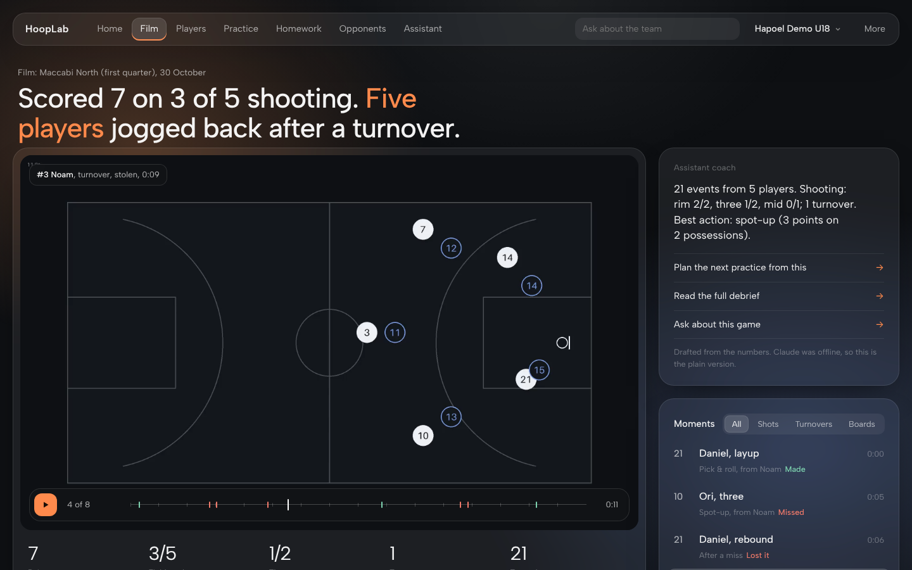

<div dir="rtl">

# HoopLab: עוזר מאמן מבוסס AI לקבוצות כדורסל

[English](README.md)



המאמן מעלה את הסגל, סרטוני משחקים ואימונים (או מתייג אירועים מהספסל), ו-HoopLab לומד כל שחקן: במה הוא חזק, על מה הוא צריך לעבוד, וכמה המערכת בטוחה בכל קביעה. על בסיס זה המערכת מייצרת תמונת מצב קבוצתית, תוכניות אימון מותאמות לקבוצה ולתנאים, שיעורי בית אישיים לכל שחקן ותוכנית משחק מול היריבה הבאה. היא ממשיכה ללמוד ממשחקים חדשים, מתוצאות שיעורי הבית ומהתרגילים שהמאמן אוהב.

## AI נייטיב

המערכת רצה על **Claude Opus 5.5**, וה-AI נמצא בתוך לולאת האימון עצמה:
* **סיכום אחרי כל משחק ואימון**: ברגע שנכנסים נתונים, Claude כותב מי עלה על הציפייה של המודל ומי ירד ממנה, מה סוגי המהלכים אומרים, ומה לעשות באימון הבא. הסיכום מגיע לתיבת התובנות של המאמן.
* **הודעה אישית לכל שחקן**: חוזקה להמשיך לנצל, על מה עובדים השבוע ולמה, שיעורי הבית עם היעד, והסרטון לצפייה לפני. מוכנה לשליחה בוואטסאפ, בעברית או באנגלית.
* **"שאל את העוזר" מכל מסך**: מכרטיס שחקן, מתוכנית אימון, מיריבה או מתובנה, והעוזר יודע על מה המאמן מסתכל.
* **עוזר מאמן (סוכן)**: שיחה בעברית או באנגלית, בהקלדה או בהכתבה קולית. הסוכן קורא את מודל הקבוצה, בונה אימונים, מחלק שיעורי בית, רושם את מה שהמאמן מדווח, ומצטט את הנתונים שעליהם הוא מתבסס.
* **הערות מאמן לנתונים**: טקסט חופשי ("נועם 3 מ-5 לשלוש, איבד פעמיים מול לחץ") הופך לאירועים במודל.
* **ניתוח צילומי משחק**: קריאת תמונות או פריימים מווידאו, תיוג אירועים לפי מספר חולצה והערות סקאוטינג.
* **עיצוב תרגילים חדשים** כשאין בספרייה תרגיל שמתאים.
* **זיכרון של העדפות המאמן** שנשמר לכל השיחות הבאות.
* **סקאוטינג עצמי ופלייליסטים**: "מה עובד לנו?" עם נקודות לפוזשן לפי סוג מהלך, ופלייליסט של הפוזשנים עצמם.
* **דוח סקאוטינג של עמוד אחד** על היריבה הבאה.

הסטטיסטיקה עצמה נשארת דטרמיניסטית, כך שהסוכן לא יכול להמציא מספרים.

## מה המערכת עושה

* **כל מספר נפתח לסרטון**: לחיצה על מיומנות, סוג מהלך או נטייה של היריבה מנגנת בדיוק את הפוזשנים שמאחוריהם.
* **סוגי מהלכים ונקודות לפוזשן (PPP)**: פיק אנד רול, ספוט אפ, פוסט, קאט, מתפרצת. לקבוצה, לשחקן וליריבה.
* **התקדמות לאורך זמן**: גרף שבועי לכל שחקן ולכל מיומנות.
* **תיבת תובנות למאמן**: סיכומי משחקים, מגמות מובהקות, שיעורי בית באיחור ושחקנים שחסר עליהם מידע.
* **תמונת מצב קבוצתית**: יתרונות לניצול, עדיפויות לאימון, מי משתפר (רק מגמות מובהקות סטטיסטית).
* **כרטיס שחקן** עם 10 מיומנויות, טווח ביטחון והשוואה למה שמצופה מהעמדה שלו.
* **תוכנית אימון** לפי זמן, מספר שחקנים, סלים, מגרש מלא או חצי מגרש ועצימות, ומותאמת ליריבה הקרובה.
* **סגל**: הוספה, עריכה או ייבוא מקובץ CSV.
* **תיוג תוך כדי צפייה**: מנגנים את הסרטון בתוך המתייג וכל תיוג נשמר עם הקליפ שלו.
* **שיעורי בית** אישיים עם יעד מדיד, ופלייליסט של הטעויות של השחקן לצפייה לפני התרגיל. התוצאות חוזרות למודל.
* **השוואה ליריבה ותוכנית משחק** עם הראיות שמאחורי כל המלצה.
* **לומדת את המאמן**: "עוד כאלה" ו"פחות" על תרגילים משנים את ההמלצות הבאות, גם לתרגילים דומים.
* **ניתוח וידאו**: החזקת כדור, מסירות, אסיסטים, איבודים, חטיפות, זריקות (כולל אזור במגרש), ריבאונדים, חזרה להגנה, מרחק ומהירות.
* **תדריך כתוב** באנגלית או בעברית (Claude כשיש מפתח API, ותבנית קבועה בלי מפתח).

## איך זה בנוי

החלטות התכנון ואיך המערכת נבדקת מפורטים ב-[docs/design.md](docs/design.md).

## הרצה

</div>

```bash
pip install -e ".[dev]"
uvicorn hooplab.api:app --reload
# לפתוח http://localhost:8000 וללחוץ "open a demo team"
pytest
```

