# HoopLab: an AI assistant coach for basketball teams

[עברית](README.he.md)

A coach uploads the roster, game and practice video (or tags events from the
bench), and HoopLab learns each player: what they are good at, what they need
to work on and how sure it is about each claim. From that it builds a team
snapshot, practice plans tailored to the team and the day's conditions,
personal homework for every player, and a game plan against the next opponent.
It keeps learning: from new games, from homework results and from which drills
the coach likes.

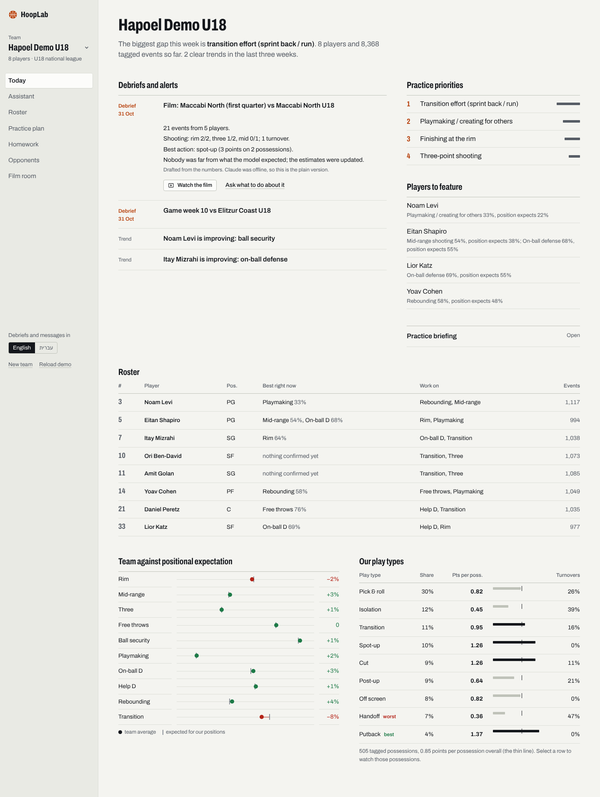

| | |
|---|---|
| 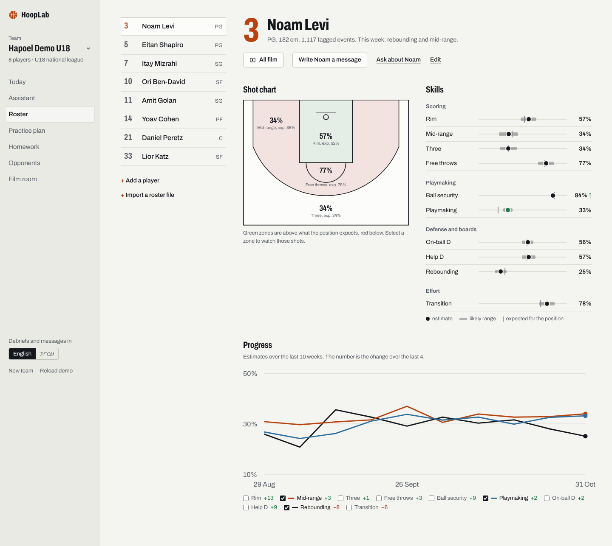 | 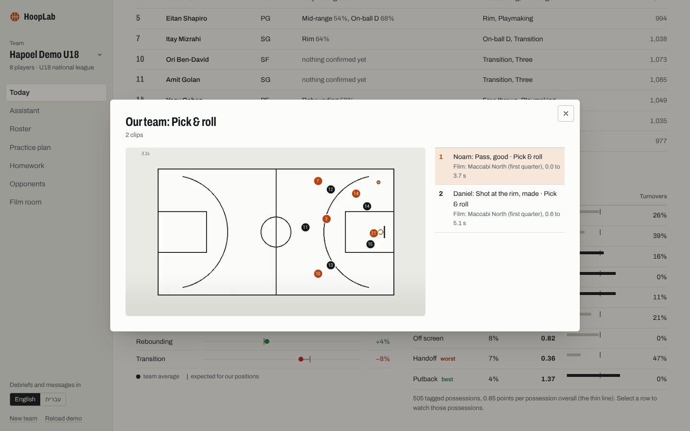 |
| 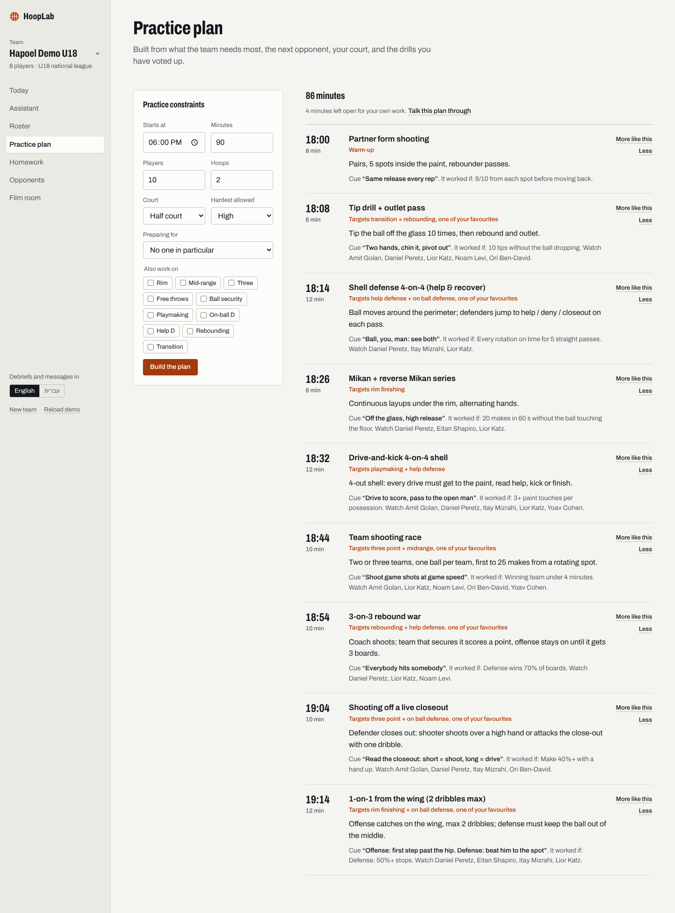 | 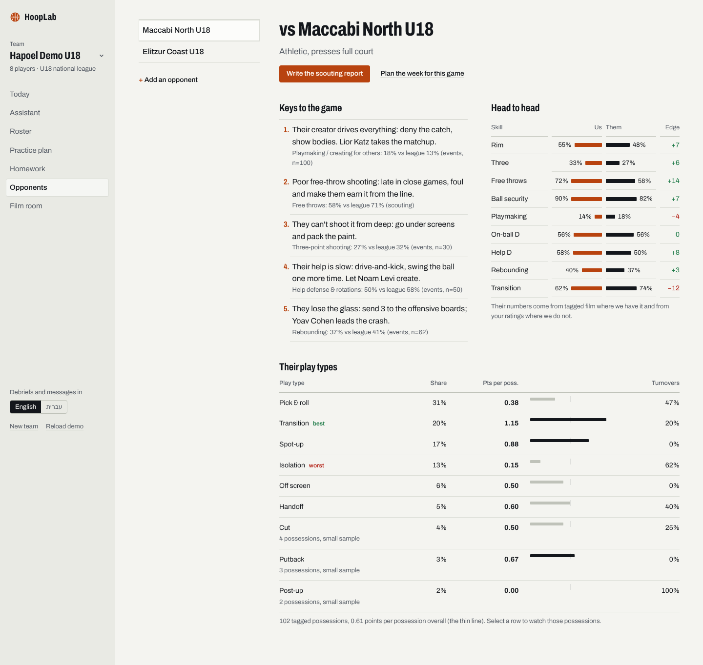 |
| 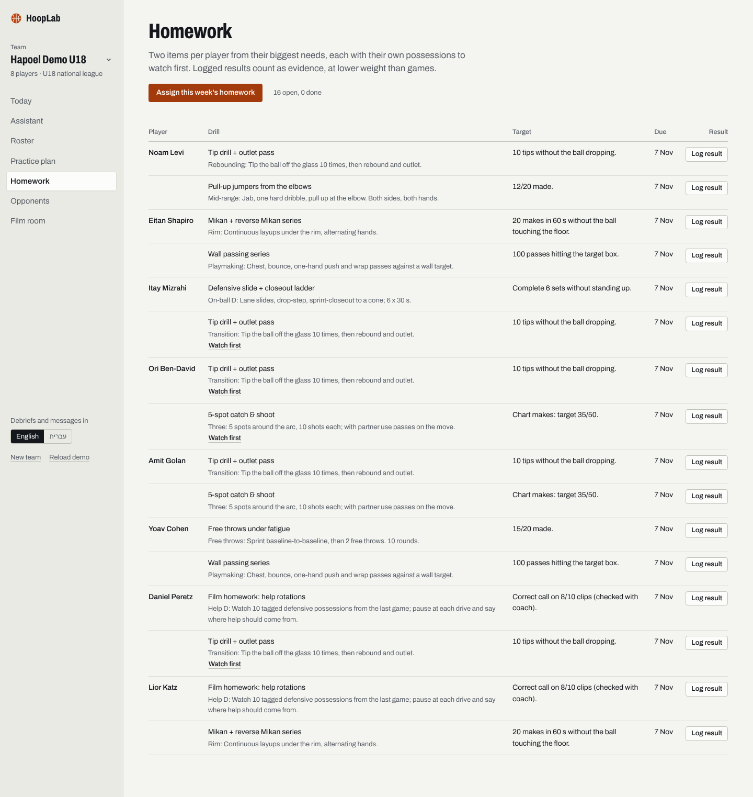 | 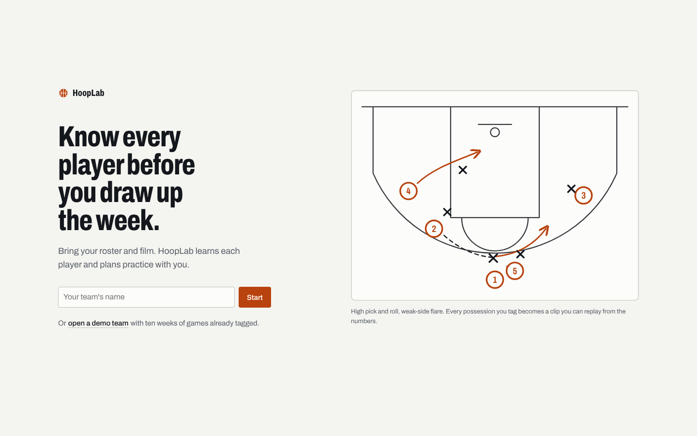 |
| 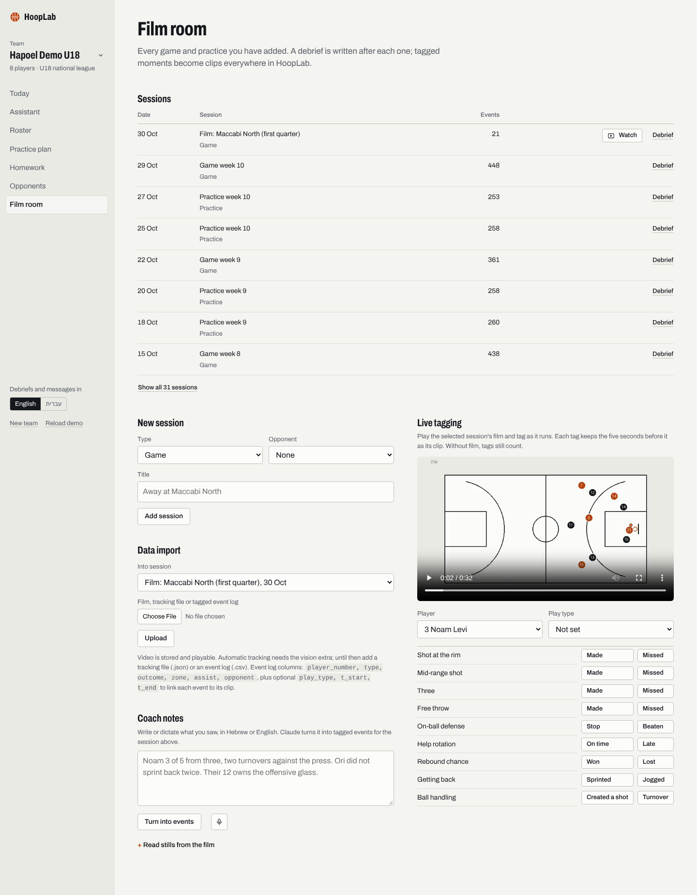 | 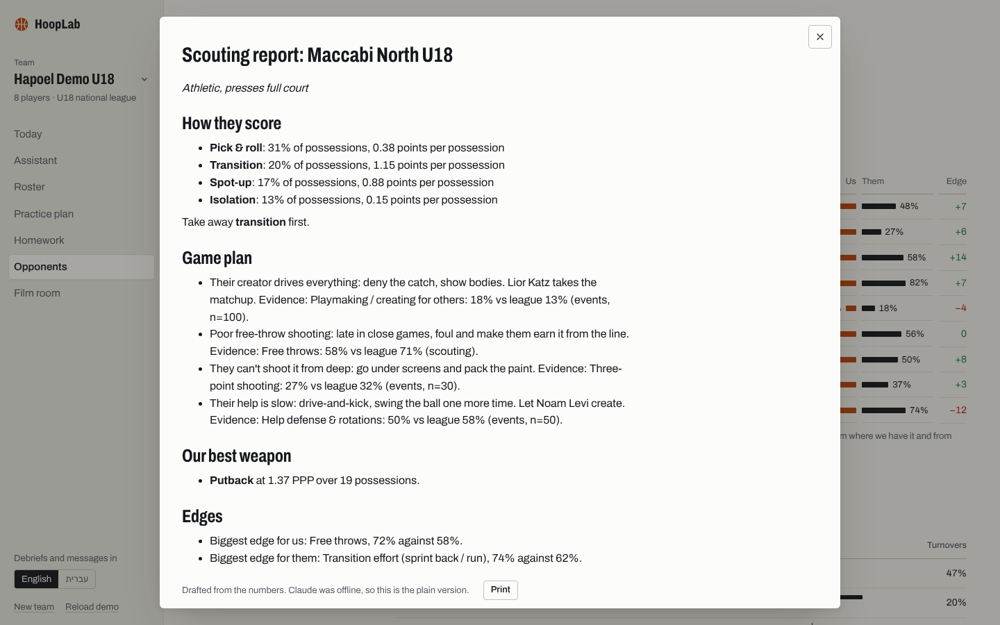 |
| 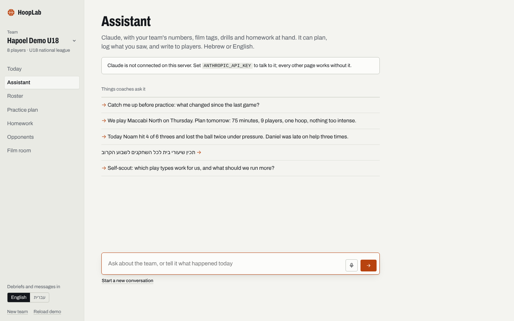 | 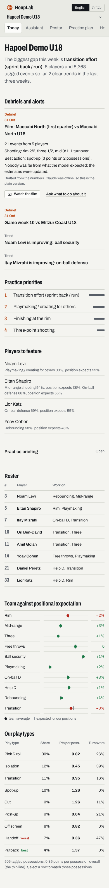 |

## AI-native by design

HoopLab runs on **Claude Opus 5.5** (`claude-opus-5-5`, configurable with
`HOOPLAB_MODEL`). Claude works inside the coaching loop: every game or practice that comes in is debriefed, every player gets a message
written for them, and the assistant can be asked about whatever the coach is
looking at, from any screen.

| | What Claude does | How |
|---|---|---|
| **Assistant coach agent** | Chat in Hebrew or English, typed or dictated: "we play Maccabi Thursday, plan 75 min for 9 players on one hoop". The agent reads the team model, builds the plan, assigns homework, logs what the coach reports and quotes the evidence. "Ask the assistant" on a player, a plan, an opponent or an inbox item opens the chat with that context | Tool-use agent loop over 16 strict-schema tools wrapping the engine (`hooplab/agent.py`); screen context passed with the question; prompt caching on tools, instructions and the conversation; conversations persisted append-only |
| **Debrief after every session** | As soon as a game or practice is imported (film, CSV, notes), Claude writes the debrief: who beat or missed the model's expectation and by how much, what the play types say, one thing for the next practice. It lands in the coach's inbox | Deterministic session report (each player vs. their own pre-session estimate), Claude writes from it, template fallback (`hooplab/coach_ai.py`) |
| **A message for every player** | Strength to keep using, what we work on and why, this week's homework with its target, the film to watch first, real progress. Ready to send on WhatsApp, in Hebrew or English | Facts from the model and homework, Claude writes; encouragement only from statistically significant trends |
| **Coach notes → data** | "Noam 3/5 from three, lost it twice vs pressure, their #12 owns the glass" becomes 7 events + a scouting note | Structured outputs with a Pydantic schema, roster matching, stored at 0.7 weight (`hooplab/perception.py`) |
| **Film AI** | Reads game stills or sampled video frames, tags events by jersey number, writes scouting observations | Claude vision, stored at 0.5 weight |
| **Designs drills** | When the library has no fit (one hoop, 5 players, a specific opponent action) it designs a drill that then feeds plans and homework | `design_custom_drill` tool → team drill library |
| **Learns the coach** | Remembers durable preferences ("hates conditioning without a ball") and uses them in every conversation | `remember_coach_preference` + the drill-preference model behind "More like this" and "Less" |
| **Self-scout & playlists** | "What works for us?" answered with points per possession by play type, backed by a playlist of the actual possessions | `get_play_types` + `build_playlist` tools |
| **Scouting report** | A one-page report on the next opponent: how they score, what to take away, how to attack them, keys to the game | Claude writes from an engine fact sheet, template fallback (`hooplab/llm.py`) |
| **Weekly briefing** | Writes the coach's briefing from the team model | Single structured call, template fallback |

Every request uses adaptive thinking with explicit effort, and the server-side
refusal fallback (`fallbacks: "default"`). The statistics stay deterministic,
so the agent cannot invent a number: it can only quote tool results.

## What it does

| For the coach | How |
|---|---|
| **Coach's inbox**: debriefs, significant trends, overdue homework, players the model knows too little about | Debriefs posted automatically after each import; alerts computed live from the model |
| **Progress over time** for every player and skill | Week-by-week skill estimates rebuilt from the events available at each date |
| **Team snapshot**: strengths to exploit, team priorities, who is improving | Bayesian skill model over 10 dimensions per player, compared with what is expected for their position |
| **Player cards** with honest uncertainty | 80% intervals; a strength/weakness is only claimed when the interval clears the positional baseline |
| **Practice plans** for the time, players, hoops, court (full or half) and intensity available | Greedy time-budgeted planner over a 30-drill library, weighted by team need, opponent and coach taste |
| **Homework** per player, with a measurable target and film to watch first | Solo drills for each player's top two needs, each with an auto-built playlist of the player's own misses; logged results flow back as evidence at reduced weight |
| **Every number opens its film** | Click a skill, a play type or an opponent tendency and watch exactly those possessions | Each event keeps its clip window in the session video; clip player plays them back to back |
| **Play types & points per possession** | Self-scout (team and player) and how each opponent scores: pick & roll, spot-up, post-up, cut, transition… | PPP, frequency and turnover rate per play type, small samples flagged |
| **Opponent comparison & game plan** | Scouting from opponent events in your game video plus manual ratings, compared with your team; rule-based tactical insights with the evidence shown |
| **Learns the coach** | "More like this" and "Less" on drills update a preference model that generalises through drill tags |
| **Roster in seconds** | Add players one by one, edit them, or import a CSV roster |
| **Tag while watching** | Play a session's film in the tagger; every tag keeps its clip window and play type |
| **Video → events** | Possession, passes, assists, turnovers, steals, shot attempts/makes with court zone, rebounds, sprint-back effort, distance and top speed |
| **Briefing** in English or Hebrew | Template by default; Claude rewrites it when `ANTHROPIC_API_KEY` is set (numbers always come from the engine) |

## Architecture

```
 video ──► [YOLO + tracker]* ──► track file ──► vision.analysis ──┐
 bench tagger / CSV ──────────────────────────────────────────────┼─► events (SQLite)
 homework results (weight 0.3) ───────────────────────────────────┘        │
                                                                           ▼
                        skills.py  Beta posteriors · positional priors · time decay
                                                                           │
          insights.py  snapshot · significant trends · matchup · plan · homework
                                                                           │
                    drills.py  library · planner · coach preference model  │
                                                                           ▼
                         api.py (FastAPI) ──► static UI   (* optional extra)
```

* `hooplab/vision/analysis.py`: tracks → events. Pure geometry, unit-tested on synthetic scenes.
* `hooplab/vision/backends.py`: optional YOLO + ByteTrack backend with jersey-colour team split.
* `hooplab/skills.py`: event → (dimension, success) mapping and the player model.
* `hooplab/insights.py`: team snapshot, trend tests, opponent matchup, plan and homework.
* `hooplab/drills.py`: drill library, planner, preference learning.
* `hooplab/agent.py`: the assistant-coach agent (Claude + engine tools).
* `hooplab/perception.py`: notes and film → events (structured outputs, vision).
* `hooplab/coach_ai.py`: session debriefs, the coach's inbox, progress over time and player messages.
* `hooplab/llm.py`: weekly briefing and opponent scouting report, with deterministic fallbacks.
* `hooplab/ingest.py`: the one write path for events (API, perception, demo film).
* `hooplab/vision/render.py`: renders a track file to MP4 (the demo film).

Design decisions and how the system is validated: [docs/design.md](docs/design.md).

## Run it

```bash
pip install -e ".[dev]"
uvicorn hooplab.api:app --reload
# open http://localhost:8000 and click "open a demo team"
```

AI features: `pip install -e ".[ai]"` and set `ANTHROPIC_API_KEY` (or `ant auth login`).
Video processing: `pip install -e ".[vision]"`. Without a key, everything except
the AI features keeps working and the API answers AI calls with a clear 503.
Docker: `docker build -t hooplab . && docker run -p 8000:8000 hooplab`.

Tests: `pytest` (40 tests: geometry, video event detection, skill model,
insights on the seeded demo team, play types and clips, the rendered demo film,
debriefs, progress, player messages, roster import, practice conditions,
concurrent API access, and the agent/perception contracts against a scripted
Claude client).

## Getting data in

1. **Video**: upload to a session. With the vision extra installed, it is
   detected, tracked and analysed in the background. Shot detection needs
   weights with a hoop class (`HOOPLAB_YOLO_WEIGHTS`); the stock COCO model
   covers players and ball.
2. **Track file**: from any tracker, in the [track format](docs/track-format.md).
   Try `examples/demo_tracks.json`.
3. **Bench tagger**: one tap per event under *Live tagging* in the Film room.
4. **CSV**: `examples/tagged_events.csv`.

## Honest limits

* The video path is validated on synthetic tracks; real footage depends on the
  detector's quality, and on-ball/help defense still come from tagging.
* Positional baselines are reasonable amateur-level priors. For league-accurate
  numbers, replace `BASELINE` in `skills.py` with your league's numbers.
* The demo team and opponents are simulated. The demo film is rendered from
  synthetic tracks (needs `ffmpeg`), so the clip player has real video to play.
* The AI features are tested against a scripted client; run them with your
  own key before a demo.

## API

Interactive docs at `/docs`. Main routes: `POST /api/demo`, `GET
/api/teams/{id}/snapshot`, `GET /api/teams/{id}/briefing?lang=he`, `POST
/api/teams/{id}/plan`, `POST /api/teams/{id}/feedback`, `POST
/api/teams/{id}/homework/assign`, `GET /api/opponents/{id}/matchup`, `GET
/api/teams/{id}/play-types`, `GET /api/teams/{id}/clips`, `POST
/api/teams/{id}/playlists`, `GET /api/opponents/{id}/scouting-report`, `GET
/api/teams/{id}/inbox`, `POST /api/sessions/{id}/debrief`, `GET
/api/players/{id}/history`, `GET /api/players/{id}/message`, `POST
/api/teams/{id}/players.csv`, `POST
/api/sessions/{id}/tracks|video|events|events.csv`.

MIT licence.
